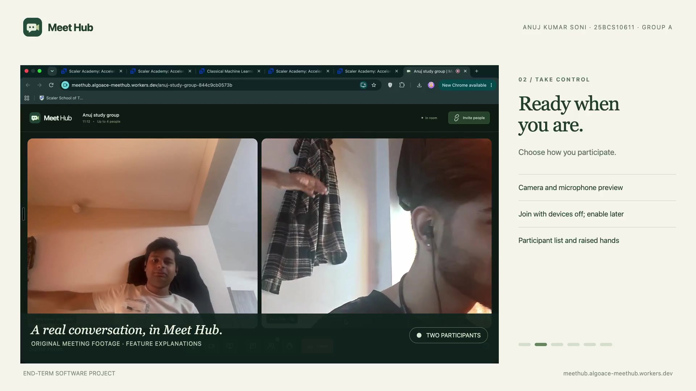

# Meet Hub

Browser video rooms for small study groups and quick project discussions. Create one link, check your devices, and meet with up to four people without an account or an app installation.

**[Open Meet Hub](https://meethub.algoace-meethub.workers.dev)** · [Alternative frontend](https://meethub-pink.vercel.app) · [Watch the demo](https://meethub.algoace-meethub.workers.dev/demo/index.html) · [Architecture](docs/ARCHITECTURE.md) · [Testing](docs/TESTING.md) · [Deployment](DEPLOYMENT.md)

## Recorded presentation

[](https://meethub.algoace-meethub.workers.dev/demo/index.html)

**[Watch the presentation](https://meethub.algoace-meethub.workers.dev/demo/index.html)** · **[Download the MP4](https://raw.githubusercontent.com/Algoace1403/meethub/main/public/demo/meethub-demo.mp4)** · [English captions](public/demo/captions.vtt)

The **4 minute 21 second, 1080p** presentation covers the problem, solution, implementation and feature overview. It includes the original **2 minute 2 second meeting recording supplied by Anuj Kumar Soni**, with real camera feeds and deep male ElevenLabs AI narration. Feature explanations accompany the footage; an actual screen-sharing demonstration has not yet been added. Meet Hub itself does not record calls—the supplied footage was captured separately.

## Problem statement

A student coordinating a short study session needs to get a small group into the same conversation quickly. Account creation, installed meeting clients and unclear invitation flows add friction. The essential workflow is a shared room link that opens directly in the browser, with clear device permissions and connection feedback.

## Target users

Students working in groups of two to four, classmates discussing an assignment, and small project teams that want an informal call. Meet Hub is intended for small temporary conversations, rather than large classes, permanent workspaces or meetings that require verified identities and host moderation.

## Solution and important workflows

1. **Create and invite:** name a meeting, generate a unique room link, and copy or share it. Guests open the same Meet Hub site.
2. **Check devices and join:** enter a display name, preview devices, or join with the camera and microphone off and enable them later.
3. **Collaborate:** exchange live audio/video, share a screen, send room chat messages, inspect participants and raise a hand.
4. **Recover and leave:** receive connection feedback, retry interrupted media/signaling, leave, and reopen a recent room.

The application processes real room membership, peer negotiation, chat, device state and recovery. Participant data is generated by live clients; there is no hardcoded meeting backend or embedded third-party meeting UI.

## Key features

- Anonymous browser meetings with a four-person capacity limit.
- Native WebRTC audio/video and screen sharing; optional TURN relay support.
- WebSocket signaling, room isolation and server-attributed chat.
- Connection timeouts, heartbeat checks, exponential reconnects and stale-negotiation handling.
- Latest 50 chat messages retained while a hosted room is active.
- Device permission errors, device-free joining, participant status and responsive layouts.
- Local recent-room links and display-name preferences.

## Tech stack

| Layer              | Technology                                                  | Purpose                                                           |
| ------------------ | ----------------------------------------------------------- | ----------------------------------------------------------------- |
| Interface          | React, JavaScript, CSS                                      | Home, prejoin, meeting and help screens                           |
| Build              | Vite                                                        | Development proxy and production assets                           |
| Media              | Browser WebRTC and Media Capture APIs                       | Direct peer media, device controls and screen-track replacement   |
| Room transport     | WebSockets                                                  | Membership, chat, status and SDP/ICE signaling                    |
| Hosted backend     | Cloudflare Workers and Durable Objects                      | One authoritative room coordinator per room                       |
| Hosted persistence | Durable Object SQLite-backed storage and socket attachments | Bounded room history and membership restoration after hibernation |
| Local backend      | Node.js and `ws`                                            | Local development and standalone hosting                          |
| Verification       | Node test runner, Playwright, Prettier                      | Backend/client tests, browser workflows and formatting            |

## Architecture and engineering decisions

The frontend connects to `/signal?room=...`. The room backend validates membership and routes connection messages only between members of that room. Browsers negotiate their own media connections; the room server does not receive or record media. When direct media cannot connect, configured TURN servers relay the encrypted WebRTC traffic.

A peer mesh keeps infrastructure small for the explicit four-person limit. It would be an inappropriate design for a large classroom: each participant sends media to the other participants. Durable Objects provide one coordinator and storage scope per room; a separate local Node adapter supports development without cloud credentials.

Accounts are deliberately absent: anyone with a room link can join until the room is full. A display name is not a verified identity. Share links only with intended participants. Private accounts, moderation, recording and permanent chat archives are outside the product scope.

See [architecture, state model, security boundaries and tradeoffs](docs/ARCHITECTURE.md).

## Local setup

Requires **Node.js 22.12+**, npm, and a modern browser. Screen sharing requires browser support; remote devices require HTTPS for camera/microphone access.

```sh
git clone https://github.com/Algoace1403/meethub.git
cd meethub
npm ci
cp .env.example .env
npm run build
npm start
```

Open **http://localhost:3001/**. The Node process serves the built frontend and room WebSocket endpoint. Stop it with Ctrl+C. Browser cameras and microphones work on localhost; sharing this localhost URL with someone on another device will not connect to your computer.

For frontend development, run `npm run server` and `npm run dev` in separate terminals, then open the Vite URL. Its `/signal` proxy connects to the local room server. Build again before using `npm start` after frontend changes.

## Environment variables

`.env.example` contains safe examples. Vite reads `.env` at build/development time; `npm start` and `npm run server` load the same file for the local Node backend. Hosted backend values belong in Cloudflare variables or secrets, not a frontend build.

| Variable                              | Scope                       | Default / use                                                                                       |
| ------------------------------------- | --------------------------- | --------------------------------------------------------------------------------------------------- |
| `VITE_SIGNALING_URL`                  | Public frontend, build time | Blank uses the same-origin room server; the supplied Vercel frontend defaults to the project Worker |
| `VITE_ICE_SERVERS`                    | Public frontend, build time | JSON ICE server fallback, default Cloudflare public STUN; never put provider account keys here      |
| `PORT`                                | Local Node backend          | `3001`                                                                                              |
| `ALLOWED_ORIGINS`                     | Backend                     | Allowed browser frontend origins; same-origin clients are also accepted                             |
| `MAX_PARTICIPANTS`                    | Backend                     | `4`, constrained to 2–4                                                                             |
| `MAX_ROOMS`                           | Local Node backend          | `50`, constrained to 1–200; not a global Worker room limit                                          |
| `ICE_SERVERS_JSON`                    | Backend secret              | Optional client ICE configuration; overrides the relay integrations                                 |
| `METERED_APP_NAME`, `METERED_API_KEY` | Backend secrets             | Optional Metered TURN credential provider                                                           |
| `TURN_KEY_ID`, `TURN_API_TOKEN`       | Backend secrets             | Optional Cloudflare TURN credential provider                                                        |
| `WORKER_TEST_URL`                     | Tests                       | Explicit target for the Cloudflare integration suite                                                |
| `E2E_BASE_URL`                        | Browser tests               | Optional public deployment; blank starts an isolated local server                                   |
| `PLAYWRIGHT_CHANNEL`                  | Browser tests               | `chrome`; set to another installed Chromium channel if needed                                       |

Account API keys remain on the backend. Clients receive the ICE credentials required to connect media. The repository does not contain deployment secrets or provision a paid relay automatically.

## Data and persistence

| Data                                     | Location                               | Lifetime                                                            |
| ---------------------------------------- | -------------------------------------- | ------------------------------------------------------------------- |
| Display name and five recent room links  | Browser local storage                  | Until the user clears that browser's storage                        |
| Hosted room title and latest 50 messages | Durable Object storage                 | While the room is occupied; deleted when the last connection leaves |
| Hosted participant membership            | WebSocket attachments                  | Active connection/session, restored when an idle room wakes         |
| Local Node room membership/chat          | Process memory                         | Until the room empties or the Node process stops                    |
| Camera, microphone and screen media      | Browser connections / configured relay | Live call only; Meet Hub does not record it                         |

## Testing and validation

```sh
npm run verify
npm run test:e2e
WORKER_TEST_URL=https://meethub.algoace-meethub.workers.dev npm run test:worker
```

`npm run verify` checks formatting, runs standard tests and builds. The five cloud integration tests are intentionally skipped without `WORKER_TEST_URL`. The browser suite uses installed Google Chrome and synthetic devices; run `npx playwright install chromium` and set the configuration channel appropriately if Chrome is unavailable. Details and manual physical-device checks are in [docs/TESTING.md](docs/TESTING.md).

## Deployment and availability

The primary public application is **https://meethub.algoace-meethub.workers.dev**. The alternative Vercel frontend uses the same project room backend. Public production links work without a hosting account; individual Vercel preview URLs may require the owner's hosting login.

TURN relay configuration and actual two-way relayed video were verified on 27 October 2026. Relay availability and provider quotas can change. Public STUN remains the fallback if relay credentials are missing or unavailable; STUN alone cannot connect every network. No permanent availability guarantee is made. See [DEPLOYMENT.md](DEPLOYMENT.md) for deployment and recovery instructions.

## Project provenance and submission

The current application implements its own room protocol and native WebRTC client. An earlier experiment customized Jitsi Meet; that implementation was replaced. The current app does not import Jitsi packages, embed its UI or use its meeting backend. The custom Meet Hub artwork and visual identity were carried forward. See [provenance and development history](docs/PROVENANCE.md), [submission details](SUBMISSION.md) and the [demo guide](docs/DEMO.md).

Original Meet Hub code/artwork are proprietary under [LICENSE](LICENSE). Third-party dependency notices are retained in [public/THIRD_PARTY_NOTICES.txt](public/THIRD_PARTY_NOTICES.txt). AI assistance was used for implementation, debugging, refactoring, documentation and verification; the student remains responsible for understanding and explaining the submitted work.
