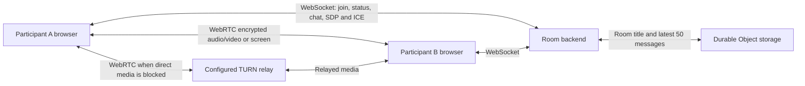

# Architecture and technical decisions

## Components

Production serves static Vite assets from Cloudflare Workers. The alternative Vercel frontend connects to the same Worker. `/signal?room=<id>` routes to the Durable Object selected by `idFromName(room)`. The Worker obtains optional ICE credentials before forwarding the socket upgrade. Credentials and membership remain scoped to that connection.

The local Node adapter serves `dist/` and handles the same JSON message protocol using `ws`. Its rooms live in memory. It is an alternative runtime, not an additional production dependency.

## Source map

| File                          | Responsibility                                                         |
| ----------------------------- | ---------------------------------------------------------------------- |
| `src/App.jsx`                 | Same-site route selection and navigation                               |
| `src/pages/Home.jsx`          | Unique room creation, link input and recent rooms                      |
| `src/pages/Help.jsx`          | Product instructions and data-lifetime explanation                     |
| `src/Room.jsx`                | Prejoin/meeting/left phases, capture, controls and collaboration state |
| `src/components/`             | Video tiles and invitation dialog                                      |
| `src/meeting.js`              | Peer connections, signaling, heartbeat, reconnect and media recovery   |
| `src/urls.js`, `src/rooms.js` | Invitation origins and display titles                                  |
| `worker/index.js`             | Production room routing, authoritative membership and persistence      |
| `server/meeting-server.mjs`   | Local Node implementation of the room protocol                         |
| `server/ice-config.mjs`       | Server-only ICE credentials, provider integration and caching          |
| `tests/`, `e2e/`              | Protocol/client regression tests and actual browser workflows          |

## Room and message model

A room has a validated identifier, display title, up to four members and the latest 50 chat messages. A member contains a server-generated ID, a private resume token, display name, joined time and microphone/camera/screen/hand flags. Public member views omit the token. Each chat message contains a generated ID, authoritative sender ID/name, text and timestamp.

Clients join before sending room actions. Signaling recipients must be members of the same room. Display names and chat are bounded and stripped of control characters. React renders chat as text, so HTML-looking messages are not interpreted as markup.

## Media and recovery

1. Device permissions are requested from an explicit user action. A guest may join without devices.
2. The server sends peers and ICE configuration when membership is accepted.
3. Browsers create audio/video transceivers. One initial offerer is elected by participant IDs, then polite negotiation handles later changes.
4. SDP and ICE travel through the room server; audio/video travels directly or through TURN.
5. Screen sharing replaces the outgoing video track, then restores the camera track when stopped.
6. Join timers, ping/pong checks and exponential reconnects detect stalled signaling. Resume tokens protect replacement sessions. Media retry creates replacement peer connections; generation IDs and ICE username fragments reject stale negotiation messages.

"In room" means signaling joined successfully; peer media has its own connecting/error status. A green room indicator alone is not proof of a working call.

## Persistence and cleanup

Durable Object storage retains the room title and latest 50 messages through hibernation. Socket attachments restore membership when the room wakes. Chat history is deleted when no joined members remain. A reconnect can preserve identity while the previous socket is still known; otherwise a guest joins as a new member. Room links are navigation identifiers, not permanently reserved resources.

The Node adapter loses rooms when the process stops. Browser local storage retains the display name and recent room links independently of room history. No call recording or permanent transcript is implemented.

## Tradeoffs

- **Four-person mesh:** avoids an SFU/media-server deployment and fits small study groups. Bandwidth and processing grow per peer; large classes would require a different media topology.
- **Anonymous room links:** reduce joining friction. A link grants access; there is no verified identity, waiting room or host moderation.
- **Ephemeral bounded chat:** fits a temporary meeting and limits retained data. It is not a durable messaging product.
- **One Durable Object per room:** gives room state a single coordinator and keeps active participants isolated. Provider availability and usage limits still apply.
- **Optional TURN:** handles networks that block direct media, at the cost of provider dependency and relay quotas. Provider secrets stay on the backend.

## Security boundaries

HTTPS/WSS protect frontend and signaling transport. WebRTC encrypts media in transit; this application does not claim verified participant identities or independently audited end-to-end identity security. The room backend enforces origin checks, capacity, message/payload bounds, rate limits, server-attributed chat and same-room routing. Resume tokens are not placed in public peer messages. Provider keys are stored as backend secrets, never in `VITE_` variables.

Origin checking protects browser usage; it is not authentication against arbitrary custom network clients. Anyone with a room link can enter. There is no global anti-abuse service, large-scale load certification or production security certification. Private account data, payments, administrative roles and recordings are outside scope.
